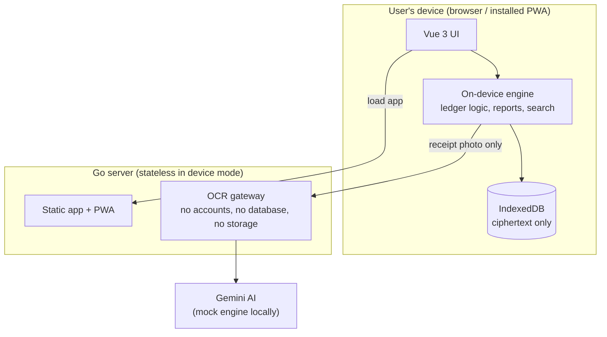
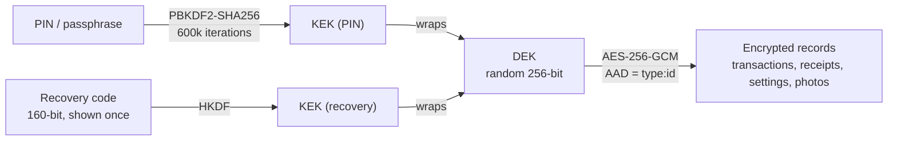
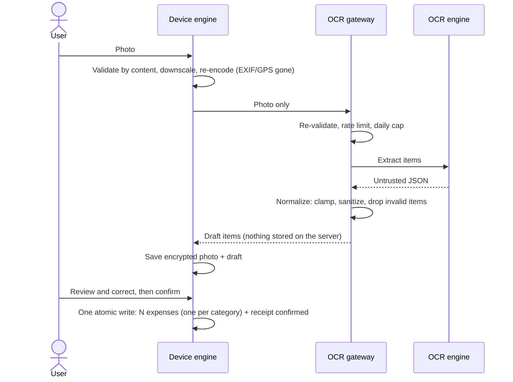
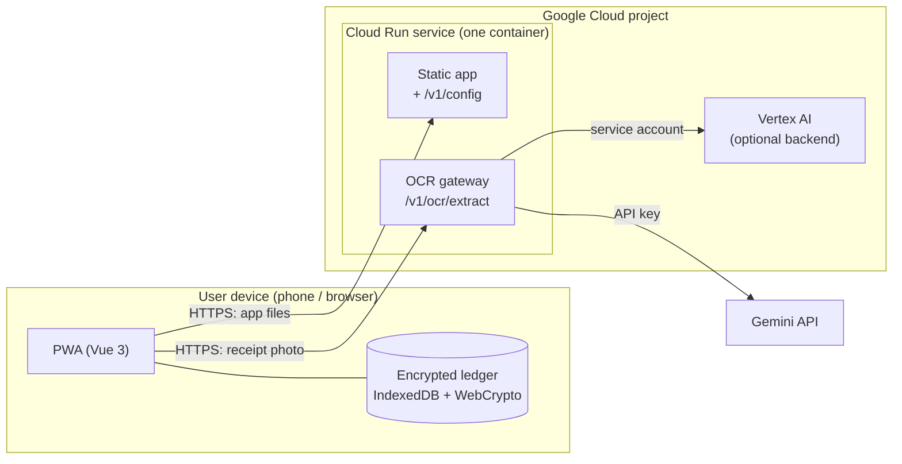
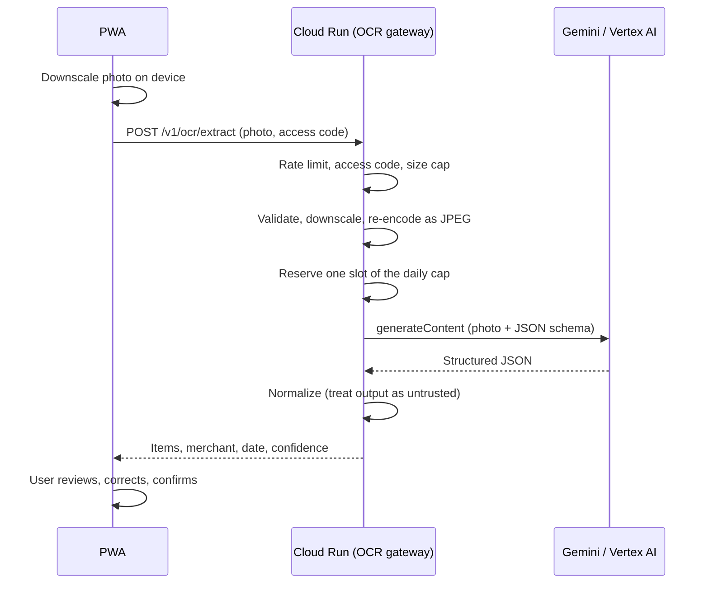

# Smart Micro-Ledger

**A local-first bookkeeping app for micro-businesses that answers one question: *"Sales are busy, so why is the cash drawer empty?"***

It keeps a **Business Wallet** and a **Personal Wallet** side by side, turns a photo of a purchase receipt into expenses, and flags **cash leaks**: months where the owner took out more money than the business actually earned.

The big idea: **your financial data never lives on my server.** Everything is stored **encrypted on the user's own device** (IndexedDB + WebCrypto). The server only serves the app and acts as a stateless OCR gateway, so a server breach has no financial data to steal.

Built with Go (standard library first), vanilla-served Vue 3 (no build step), and PostgreSQL for an optional server mode. It runs **fully locally with zero cloud services**, and the exact same code is ready for **Cloud Run + Gemini**: moving to the cloud is a few environment variables, not a code change.

---

## Why I built this

Picture a street-market vendor or a food-stall owner in Indonesia. Money lives in a paper notebook (if it's written down at all), and business cash and household cash share the same pocket. Full accounting tools like Jurnal or Accurate are way too heavy for that. And you know how it ends: the stall is always busy, yet somehow there's never cash left to restock.

The root cause is rarely low sales. It is usually **owner withdrawals quietly exceeding profit**. So the product is built around one signal:

> `profit = revenue − business expenses` vs. `net owner withdrawals (prive)`
> If withdrawals > profit, the business is being drained, and the app says so in plain language.

Since this is real people's money, I treated **privacy, security, and reliability as day-one requirements**, then went one step further: if the server never holds the data, it can't leak it.

---

## Features

| Area                                     | What it does                                                                                                                                                                       |
| ---------------------------------------- | ---------------------------------------------------------------------------------------------------------------------------------------------------------------------------------- |
| **Two wallets, one app**           | Business and Personal wallets with balances always computed from the ledger, never stored.                                                                                         |
| **Quick entry**                    | Income/expense with amount, category and note. Formatted amount input with quick-add chips (+10k/+20k/+50k/+100k).                                                                 |
| **Owner draw / capital injection** | Business → Personal is recorded as*prive*, Personal → Business as a capital deposit; both ledger rows are written atomically.                                                  |
| **Receipt scanning**               | Photo → on-device downscale (strips EXIF/GPS) → OCR → review next to the photo → correct → confirm. One expense per category. Works offline as manual entry.                  |
| **Cash-leak detection**            | Monthly report compares profit with net owner withdrawals and highlights the gap.                                                                                                  |
| **Banking-app ergonomics**         | Hide/show balance, auto-lock with PIN re-entry, history grouped by day with daily totals, 7-day income/expense chart, share the monthly summary to WhatsApp.                       |
| **Money-tracker ergonomics**       | Transaction detail + editing (amounts immutable by design), type/category/date filters, text search,**5-second Undo** on delete, spending-by-category breakdown, CSV export. |
| **Own your data**                  | Encrypted backup/restore file, backup reminders, recovery code, persistent-storage request, installable PWA that opens offline.                                                    |

---

## Architecture



There are two data modes behind one UI function, `api(method, path, body)`:

|                     | **Device mode** (default)       | **Server mode** (optional)                         |
| ------------------- | ------------------------------------- | -------------------------------------------------------- |
| Data location       | Encrypted IndexedDB on the device     | PostgreSQL (field-level encryption + Row Level Security) |
| Accounts            | None; unlocked with a PIN             | Phone + PIN, sessions                                    |
| Server stores data? | **No** (no database, no volume) | Yes                                                      |
| Multi-device        | Via encrypted backup file             | Yes                                                      |
| Device lost         | **Data lost unless backed up**  | Data safe on the server                                  |

The on-device engine mimics the server's REST contract (same JSON shapes, validation rules and error messages), so the UI does not care where data lives. Parity tests on both sides keep the two implementations from drifting.

### Key hierarchy (device mode)



- Every record is sealed with AES-256-GCM, and its **AAD binds it to its slot**, so records cannot be swapped or silently modified.
- Changing the PIN only re-wraps the DEK; no data is re-encrypted.
- Forgot the PIN? The recovery code unwraps the same DEK. Lose both and the data is unrecoverable by anyone, including me.

### How a receipt becomes expenses



---

## Security design

| Threat                                                | Defence                                                                                                                                                                                                       |
| ----------------------------------------------------- | ------------------------------------------------------------------------------------------------------------------------------------------------------------------------------------------------------------- |
| **Server breached**                             | In device mode the server holds**no financial data**: no accounts, no database, no storage. What remains is a stateless OCR gateway.                                                                    |
| **Someone holds an unlocked phone**             | Auto-lock (1 / 5 / 15 min or off), manual lock, decrypted data dropped from memory on lock, balance can be hidden.                                                                                            |
| **PIN guessing in the app**                     | Escalating delays after 3 wrong attempts.                                                                                                                                                                     |
| **Browser files copied, then attacked offline** | Contents are ciphertext.**Real protection = PIN length + KDF cost.** A 6-digit PIN can be brute-forced in minutes on a GPU, so the UI shows a strength meter and recommends an 8+ character passphrase. |
| **Tampered or swapped data**                    | AES-GCM authentication + per-record AAD: modification is detected on unlock.                                                                                                                                  |
| **Malicious or corrupt backup file**            | Strict validation, credentials verified**before** local data is replaced, sample decryption test.                                                                                                       |
| **Malicious uploads to the OCR gateway**        | Type detected from content, size/pixel limits (decompression bombs), re-encode to JPEG, hard 5 MB cap.                                                                                                        |
| **Prompt injection via text on a receipt**      | OCR output is untrusted input: sanitised, length-limited, validated; totals recomputed from items; a human always confirms.                                                                                   |
| **Abuse of the account-less OCR gateway**       | Per-IP rate limit, global daily cap (cost guard), optional access code, constant-time comparison.                                                                                                             |
| **CSV formula injection**                       | Cells starting with `= + - @` are neutralised on export.                                                                                                                                                    |
| **XSS**                                         | Strict CSP (no inline scripts/styles), Vue output escaping, self-hosted Vue (no CDN in the supply chain).                                                                                                     |
| **Service worker leaking data**                 | The SW caches only the static app shell;`/v1/*` is never cached.                                                                                                                                            |
| **Compromised container**                       | Distroless non-root image, read-only filesystem, all capabilities dropped, no data volume in device mode.                                                                                                     |

Server mode keeps its earlier defences: field-level AES-256-GCM, argon2id, hashed session tokens, PostgreSQL Row Level Security on every table, a restricted DB role, an immutable ledger trigger, and an audit log.

### Honest limitations

- **No backup = no recovery.** Lose the device without a backup and the data is gone. iOS may evict site data not opened for 7 days unless the app is installed to the home screen. The app mitigates this with backup reminders, a persistent-storage request, and an install prompt, but cannot remove the risk.
- **Offline PIN cracking** against a copied browser profile is only as hard as the PIN is long. PBKDF2 is not memory-hard; Argon2 via WASM would be stronger.
- **Receipt photos leave the device** when OCR is used (device → gateway → Gemini). The gateway doesn't store them, but what Google does with them depends on your setup: on the Gemini API free tier they may be used to improve Google's products, while billed Gemini API and Vertex AI don't use them for training. Read the terms for whichever you pick before you launch.
- **HTTPS is required** (WebCrypto is unavailable on plain-HTTP origins other than `localhost`). The app shows a clear message instead of failing silently.
- The CSP needs `'unsafe-eval'` because Vue compiles templates in the browser; removing it requires pre-compiling templates.
- Text search runs in the browser over loaded history. No automatic multi-device sync.

---

## Reliability

- **Atomic writes.** Every IndexedDB write that spans several rows (transfers, receipt confirmation) is a single transaction; data is encrypted *before* the transaction opens.
- **Graceful shutdown.** On `SIGTERM` readiness flips to "not ready", the process waits for the load balancer to drain, finishes in-flight requests, then exits.
- **Health endpoints** `/healthz` and `/readyz`, plus a `healthcheck` subcommand for distroless Docker.
- **Offline-capable.** The service worker keeps the app shell available without internet; ledger operations never need the network. Only OCR does, and it degrades to manual entry.
- **Bounded resources.** Server timeouts, request deadlines, body limits, concurrency limits around image decoding, rate limiters.
- **Server mode:** deadlock/serialization retry, idempotency keys, advisory-locked migrations.

---

## Local-first, cloud-ready

Everything runs on a laptop: the app, the on-device storage, and a **mock OCR engine** that picks a sample receipt from the image hash. The upload → review → correct → confirm flow is real; only "reading the pixels" is faked, and the UI says so.

The cloud version is **not a separate branch or a pile of commented-out code**. It's the same binary, switched by environment variables:

|             | Local (default)                   | Cloud                                                                                                                                      |
| ----------- | --------------------------------- | ------------------------------------------------------------------------------------------------------------------------------------------ |
| Receipt OCR | `OCR_BACKEND=mock` (free, fake) | `OCR_BACKEND=gemini` + `GEMINI_API_KEY` (Gemini API, has a free tier) or `OCR_BACKEND=vertex` + `VERTEX_PROJECT` (Vertex AI, paid) |
| Port        | `ADDR` (`:8080`)              | `PORT`, set by Cloud Run (picked up automatically)                                                                                       |
| Client IP   | `TRUSTED_PROXY_HOPS=0`          | `TRUSTED_PROXY_HOPS=1` (one proxy in front)                                                                                              |
| Logs        | plain slog JSON                   | Cloud Logging fields (`severity`/`message`), auto-enabled when `K_SERVICE` exists                                                    |

Because the server holds no data, the cloud footprint stays tiny: **Cloud Run for hosting, plus a Gemini model for reading receipts**. No Cloud SQL, no Cloud Storage, no Secret Manager. That's on purpose: small shops shouldn't pay for infrastructure they don't need.

---

## Quick start

Requirements: Docker (with Compose). Node 20+ and Go 1.22+ are only needed to run tests.

```bash
git clone https://github.com/<your-username>/smartledger.git
cd smartledger

docker compose up --build -d      # device mode: a single container, no database
open http://localhost:8080
```

On first run, create a PIN and **save the recovery code** shown once. To try the optional server mode (accounts + PostgreSQL):

```bash
# create .env with random secrets (Windows: scripts/init-env.ps1), then:
docker compose -f docker-compose.yml -f docker-compose.server.yml up --build -d
```

To test on a phone, use an HTTPS tunnel (e.g. cloudflared) or `adb reverse tcp:8080 tcp:8080`; plain `http://192.168.x.x` will be refused by the browser's crypto APIs.

---

## Cloud architecture

In the cloud the whole system is **one container on Cloud Run plus one outbound call to a Gemini model**. Nothing in between stores user data: the ledger lives encrypted on the user's device, and the server only serves the app and relays receipt photos. Step-by-step deployment lives in [docs/cloud-deployment.md](docs/cloud-deployment.md).



### Components

| Component                       | Runs on     | Responsibility                                     | Stores data?                                     |
| ------------------------------- | ----------- | -------------------------------------------------- | ------------------------------------------------ |
| PWA                             | User device | UI, ledger logic, encryption (PIN + WebCrypto)     | Yes, encrypted, on the device only               |
| Cloud Run service               | GCP         | Serves the app,`/v1/config`, and the OCR gateway | No (only in-memory counters)                     |
| Gemini API or Vertex AI         | Google      | Reads a receipt photo and returns structured JSON  | Not by this app; the provider's data terms apply |
| Cloud Build + Artifact Registry | GCP         | Build and hold the container image at deploy time  | The image only                                   |

### Scanning a receipt



The photo only exists in memory while the request is in flight. If anything fails (model error, quota, bad config), the gateway answers `failed: true` and the app shows the manual entry form instead of an error.

### Trust boundaries

| Boundary                  | Controls                                                                                                                       |
| ------------------------- | ------------------------------------------------------------------------------------------------------------------------------ |
| Internet to Cloud Run     | HTTPS terminated by Cloud Run, security headers (CSP, HSTS), per-IP rate limit, optional shared access code, upload size cap   |
| Uploaded photo to decoder | Image validated, downscaled, and re-encoded as JPEG (drops EXIF/GPS and hidden payloads), at most two images processed at once |
| Cloud Run to model        | Gemini: API key in an env var. Vertex AI: service account with only `roles/aiplatform.user`, no key to leak                  |
| Model output to app       | Treated as untrusted input: bounded, sanitized, and validated before it reaches the user                                       |
| Data at rest              | Nothing on the server; ledger encrypted on the device                                                                          |

### Runtime configuration

| Setting                                          | Value                               | Why                                                                                                                                                          |
| ------------------------------------------------ | ----------------------------------- | ------------------------------------------------------------------------------------------------------------------------------------------------------------ |
| `--allow-unauthenticated`                      | on                                  | It's a public web app; user data is protected by the on-device PIN, not by Cloud Run login.                                                                  |
| `--min-instances`                              | `0`                               | Scales to zero, so an idle app costs nothing. The first visit after a quiet spell takes a second or two longer.                                              |
| `--max-instances`                              | `1`                               | The daily cap and rate limits live in memory. One instance makes them truly global and puts a ceiling on the bill. Trade-off: no scale-out under heavy load. |
| `--memory` / `--concurrency` / `--timeout` | `512Mi` / `20` / `60s`        | Headroom for image decoding; the OCR call itself times out at 25 s.                                                                                          |
| `OCR_DAILY_CAP`                                | `100` (Gemini) / `300` (Vertex) | Total scans per WIB day across everyone. A failed scan still uses a slot. At the cap, users get "kuota OCR harian sudah habis" and can type the receipt in.  |
| `OCR_ACCESS_CODE`                              | random                              | The endpoint has no accounts, so this shared code is the main gate.                                                                                          |
| `TRUSTED_PROXY_HOPS`                           | `1`                               | Cloud Run puts one proxy in front. With a load balancer too, use `2`; otherwise per-IP limits see the wrong address.                                       |
| Logs                                             | stdout JSON                         | Auto-formatted for Cloud Logging when `K_SERVICE` is set.                                                                                                  |

### Choosing the OCR backend

|                                                       | `gemini` with a free key (default)    | `gemini` with a billed key | `vertex`                      |
| ----------------------------------------------------- | --------------------------------------- | ---------------------------- | ------------------------------- |
| Cost                                                  | Free within Google's quota              | Pay per scan                 | Pay per scan                    |
| Auth                                                  | API key (env var)                       | API key (env var)            | Service account, no key to leak |
| Google may use receipt photos to improve its products | **Yes**                           | No                           | No                              |
| Good for                                              | Demos, trying it out, your own receipts | Real users, simplest setup   | Real users, tightest security   |

Receipt photos contain merchant names, items, and amounts, and this app's pitch is that your financial data stays yours. Use the free tier for demos or your own receipts; put billing on the key (no code change) or switch to `vertex` for real shop owners. The server logs a warning at startup when `OCR_BACKEND=gemini`.

### Deliberately left out

- **Cloud SQL / PostgreSQL:** there is no server-side data. Server mode (accounts + PostgreSQL) is for local or a VPS only.
- **Cloud Storage:** receipt photos are never persisted in device mode.
- **Secret Manager:** the Gemini key is a plain env var, readable by anyone with access to the GCP project. That's the price of one fewer service; rotate it in AI Studio if it leaks.
- **Load balancer / CDN:** `run.app` already gives HTTPS, and a single small instance doesn't need more.

---

## Testing

```bash
go mod tidy && go test ./...                 # Go: unit + integration (integration needs the server-mode PostgreSQL)

cd tests/web && npm install
npm run test:local                           # on-device engine: crypto, vault, ledger parity, receipts, backup, CSV
npm run test:device                          # full UI flow against the running device-mode server
BASE_URL=http://127.0.0.1:8080 npm run test:server   # full UI flow against server mode
```

What the suites verify:

- **Crypto & vault:** tamper and slot-swap detection, key rotation, PIN change, recovery code, attempt throttling, and that no plaintext appears in stored bytes or in backup files.
- **Ledger parity:** the on-device engine reproduces the server's results for the cash-leak scenario, pagination, filters, edits, reports and validation.
- **Backups:** export → wipe → restore (PIN and recovery code), wrong credentials leave local data untouched, malicious files rejected, CSV injection neutralised.
- **UI end-to-end (device mode):** onboarding, weak-PIN rejection, lock/unlock, PIN change, forgot-PIN recovery, idle auto-lock, backup, wipe and restore, undo delete, receipt flow, plus the key proof: **the only endpoints called are `/v1/config` and `/v1/ocr/extract`**, never a data endpoint.
- **Gateway & server:** access code, daily cap, hostile uploads, no data endpoints in device mode, PWA assets and CSP; and in server mode, cross-user isolation, encryption at rest, immutable ledger, lockout and rate limiting.

---

## Project structure

```
cmd/api/             entry point: serve | migrate | genkey | healthcheck
internal/
  app/               wiring; device.go = stateless device-mode server; local/cloud backend factory
  receipt/           OCR gateway (no storage), mock/gemini/vertex engines, image sanitiser
  auth/ ledger/      server mode: accounts, wallets, transactions (PostgreSQL + RLS)
  platform/          db (pool, RLS context, migrator), httpx (strict JSON, middleware, rate limiter)
  config/            env parsing with fail-fast validation (STORAGE_MODE)
  web/static/        Vue UI + PWA
    assets/local-crypto.js   DEK/KEK, PBKDF2, recovery code, AES-GCM with AAD
    assets/local-db.js       encrypted IndexedDB, vault, attempt throttling
    assets/local-ledger.js   on-device ledger engine (mirrors the REST contract)
    assets/local-backup.js   backup, restore, CSV, storage status
    assets/app.js            UI; one api() for both modes
    sw.js, manifest.webmanifest
migrations/          server-mode schema
docs/                cloud-deployment.md (step-by-step deploy guide)
tests/web/           on-device engine + UI tests (Node, jsdom, fake-indexeddb)
scripts/             init-env.ps1 (server mode), ocrcheck (test the OCR backend), deploy-cloudrun.ps1
.editorconfig        shared editor settings
```

---

## Trade-offs I made on purpose

- **Local-first over cloud sync.** It removes the biggest risk (a server full of financial data) at the price of no automatic multi-device sync and a real data-loss risk. I offset that with encrypted backups and reminders instead of hiding it.
- **Two implementations of the ledger rules (Go and JS).** Server mode is kept as an option, so rules live in two places; parity tests guard against drift.
- **Gemini for OCR, not a self-trained model.** Receipt OCR (including handwriting) is a solved problem for large multimodal models, and the per-receipt cost is tiny compared with the effort and accuracy risk of training my own. The OCR engine sits behind a small interface, so it stays swappable.
- **Standard library first.** Server mode uses two runtime dependencies (`lib/pq`, `x/crypto/argon2`); device mode needs none beyond the Go standard library.
- **Vue without a build step.** Approachable and no toolchain, at the cost of `'unsafe-eval'` in the CSP.
- **Amounts are not editable.** Fixing an amount means delete + re-record, keeping the ledger trustworthy.
- **Account-less OCR gateway guarded by caps.** Simple and private, but abuse resistance is rate limits + a daily cap + an optional access code rather than identity.

---

## Code conventions

Small rules so the codebase stays easy to maintain:

- **Formatting and checks:** `gofmt` and `go vet` must be clean. `.editorconfig` covers the other file types.
- **Comments are in English** and describe what something is or why it exists. Exported Go identifiers get a doc comment that starts with the identifier's name (godoc style).
- **User-facing text stays in Indonesian** (UI copy and API error messages), because that's the audience.
- **Configuration comes from environment variables only**, parsed and validated once in `internal/config`; invalid values stop the server at startup.
- **One implementation per backend behind a small interface** (`Extractor`, `Storage`), chosen in `internal/app/factory.go`. Add a new backend there, not in handlers.
- **Tests** sit next to the code they cover. New external calls get a fake-server test so CI never needs real credentials.

---

## Showcase


---

## Tech stack

Go 1.22 · Vue 3 (self-hosted) · IndexedDB · WebCrypto (AES-256-GCM, PBKDF2, HKDF) · Service Worker / PWA · Docker Compose · PostgreSQL 16 + Row Level Security (server mode) · Mermaid (docs)

Cloud target: Cloud Run · Gemini API (free tier) or Vertex AI, nothing else
