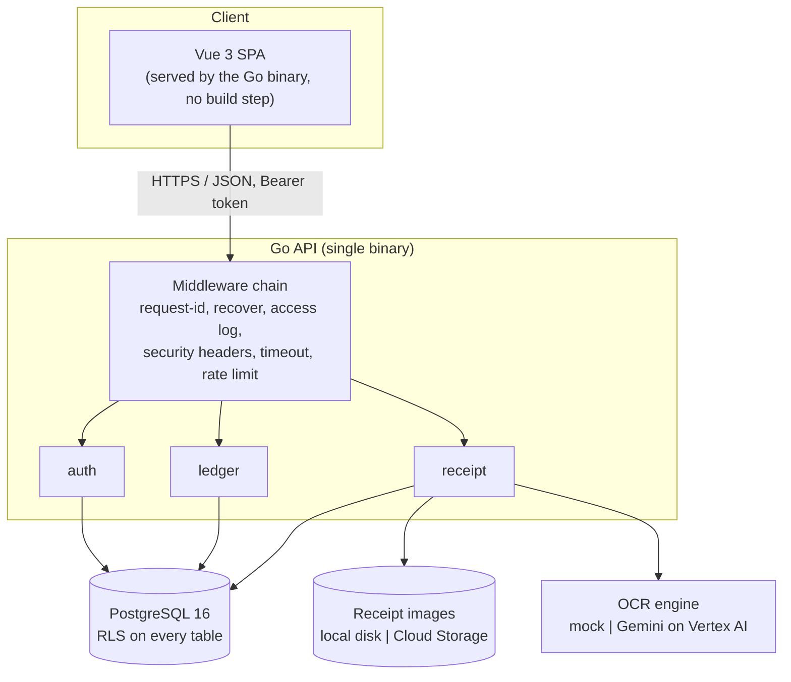
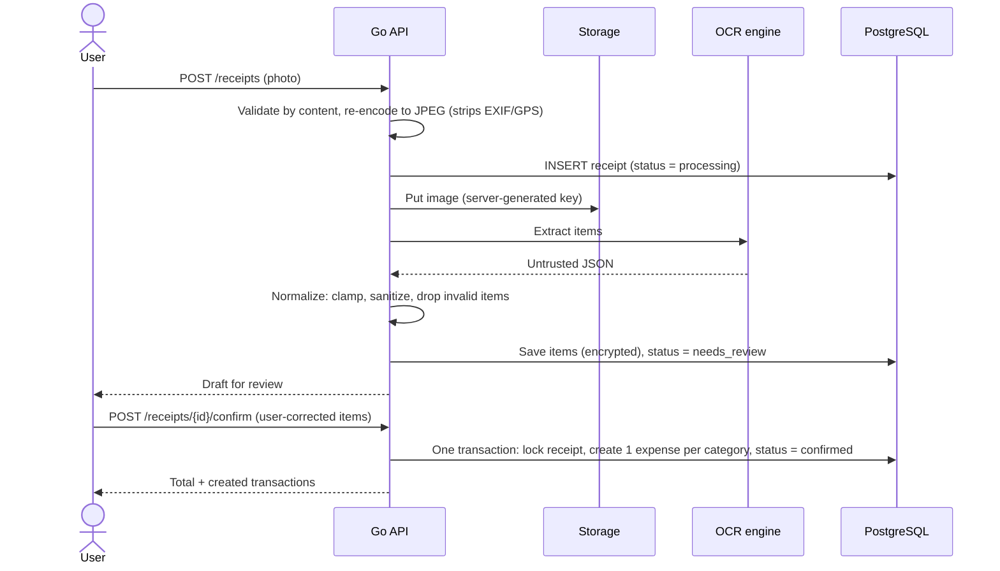
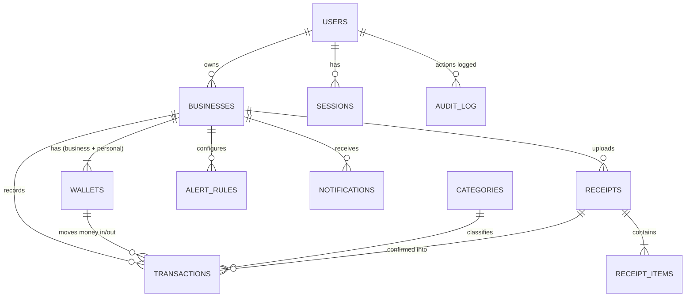

# Smart Micro-Ledger (Buku Kas Pintar)

**A bookkeeping app for micro-businesses that answers one question: *"Sales are busy, so why is the cash drawer empty?"***

Smart Micro-Ledger keeps a **Business Wallet** and a **Personal Wallet** inside a single account, lets you photograph a purchase receipt and turn it into expenses, and flags **cash leaks**: months where the owner took out more money than the business actually earned.

Built with Go (standard library first), PostgreSQL 16, and Vue 3. It runs **fully locally with zero cloud services**, and the cloud (GCP) version is already written into the code as commented lines, ready to switch on.

---

## Why I built this

Street-market vendors and food-stall owners in Indonesia usually track money in a paper notebook, and business money and household money live in the same pocket. Full accounting tools such as Jurnal or Accurate are far too heavy for them. The result is a familiar story: the stall is always busy, yet there is no cash left to restock.

The root cause is rarely low sales. It is usually **owner withdrawals quietly exceeding profit**. So instead of building "yet another accounting app", I built the product around that single signal:

> `profit = revenue − business expenses` vs. `net owner withdrawals (prive)`  
> If withdrawals > profit, the business is being drained, and the app says so in plain language.

I also treated this as a chance to build something where **the data being protected is real people's money**, so security, maintainability, and reliability were requirements from day one rather than a cleanup phase.

---

## Features

| Area | What it does |
|---|---|
| **Two wallets, one account** | Business and Personal wallets are created automatically for every business. Balances are always computed from the ledger, never stored. |
| **Quick entry** | Record income or expense with an amount, category, and note. Retrying after a network drop never creates duplicates (client-generated idempotency keys). |
| **Owner draw / capital injection** | Moving money Business → Personal is recorded as *prive*; Personal → Business as a capital deposit. Two ledger rows are written atomically. |
| **Receipt scanning** | Upload a photo, review the extracted items next to the image, correct anything, then confirm. One expense is created per category. |
| **Cash-leak detection** | Monthly report compares profit with net owner withdrawals and highlights the gap. |
| **Friendly nudges** | "This month you made Rp2,000,000 profit. Ready to save?" and a warning when the business balance goes negative. |

---

## Architecture



The `local | cloud` pairs are swapped behind two small interfaces (`Storage` and `Extractor`), so moving to GCP does not touch business logic.

### How a receipt becomes expenses



### Data model



Key modelling decisions:

- **Money is `BIGINT` in whole rupiah.** No floats, no decimals.
- **Balances are never stored.** They are derived from transactions through a view, so a balance can never drift out of sync with the ledger.
- **Transfers are two rows** sharing a `transfer_group_id` (one `out`, one `in`), written in one database transaction.
- **The ledger is immutable.** A trigger rejects changes to amount, wallet, kind, and direction; deletion is soft-delete only.

---

## Security design

Security is split into layers so that a mistake in one layer does not become a data leak.

| Threat | Defence |
|---|---|
| **Database dump stolen** | Phone number, name, transaction notes, merchant and item names, and raw OCR output are encrypted **in the application** with AES-256-GCM (keys never stored in the DB, per-column AAD, key rotation supported). PINs are hashed with argon2id. Session tokens are stored only as SHA-256 hashes. Phone lookup uses an HMAC blind index with a secret pepper. |
| **Bug or SQL injection exposing other users' data** | **PostgreSQL Row Level Security on every table**, keyed by a per-transaction `app.user_id`. The API connects as a non-owner role with no `DELETE` and no direct access to the sessions table; login and session handling go through `SECURITY DEFINER` functions. Views use `security_invoker`. A test fails if any new table forgets RLS. |
| **PIN guessing** | Per-IP rate limit on auth endpoints, temporary account lockout after repeated failures, argon2id, identical responses for "unknown account" and "wrong PIN", and equalised response timing. |
| **Tampering with numbers** | Immutable ledger trigger, audit log, bounded amounts. |
| **Malicious uploads** | File type is detected from content, not the filename. Size and pixel limits stop decompression bombs. Images are decoded and **re-encoded to JPEG**, which removes EXIF/GPS metadata and any hidden payload. Object keys are generated by the server, so there is no path traversal. Images are only served through the authenticated API. |
| **Prompt injection via text on a receipt** | OCR output is treated as **untrusted input**: sanitised, length-limited, validated, and the total is recomputed from the items. A human always confirms before anything touches the ledger. |
| **XSS / clickjacking** | Strict Content-Security-Policy (no inline scripts or styles, `frame-ancestors 'none'`), Vue output escaping, security headers on every response. Vue is self-hosted, so there is no third-party CDN in the supply chain. |
| **Secrets in logs** | Logs never contain request bodies, headers, or query strings. Internal errors go to the log with a request ID; clients only see a generic message. |
| **Compromised container** | Distroless non-root image, read-only root filesystem, all Linux capabilities dropped, database port not published, API bound to `127.0.0.1` by default. |

---

## Reliability

- **Graceful shutdown.** On `SIGTERM` the readiness probe flips to "not ready", the process waits for the load balancer to drain, finishes in-flight requests, then exits.
- **Health endpoints.** `/healthz` (liveness) and `/readyz` (database reachable), plus a `healthcheck` subcommand for Docker's distroless image.
- **Resilient startup.** The pool waits for the database with exponential backoff instead of crashing on a slow start.
- **Safe transactions.** Automatic retry on deadlock and serialization failures. Every multi-row operation (transfers, receipt confirmation) is atomic.
- **Idempotency.** Client-supplied `client_id` makes retries safe on flaky mobile connections. Receipt confirmation locks the row with `FOR UPDATE`, so a double tap cannot create duplicate expenses.
- **Bounded resources.** Server timeouts (Slowloris protection), per-request deadlines, body size limits, connection pool limits, semaphores around argon2 hashing and image decoding, and rate limiters.
- **Safe migrations.** An advisory lock prevents two instances migrating at once; each migration file runs in a single transaction.
- **Atomic file writes** for receipt images. An OCR failure never fails the user: the receipt is marked `failed` and manual entry is offered.

---

## Local-first, cloud-ready

The whole system runs on a laptop: PostgreSQL, the API, the web UI, local file storage for receipts, and a **mock OCR engine** that deterministically picks a sample receipt from the image hash. The upload, review, correction, and confirmation flow is real; only "reading the pixels" is simulated, and the UI says so.

Everything needed for GCP is **already in the source as commented lines prefixed with `// CLOUD: `**:

| Piece | Local (active) | Cloud (commented) |
|---|---|---|
| Receipt storage | Local disk, atomic writes | Cloud Storage via the JSON API |
| OCR | Mock extractor | Gemini on Vertex AI with structured JSON output |
| Credentials | Environment variables | Service-account token from the metadata server, no API keys |
| Logging | JSON logs | Cloud Logging field names (`severity`, `message`) |
| Port | `ADDR` | Cloud Run `PORT` |

Migrating means removing the `// CLOUD: ` prefix. A helper proves that the commented code is not rotting:

```bash
go run ./scripts/cloudcheck -list   # how many CLOUD lines per file
go run ./scripts/cloudcheck         # enables every CLOUD line in a temp copy, then go build + go vet
```

> The Gemini model ID is configurable (`VERTEX_MODEL`). Check Google's model lifecycle page for the current stable Flash model and its retirement date before deploying.

---

## Quick start

Requirements: Docker (with Compose). Go 1.22+ is only needed to run tests.

```bash
git clone https://github.com/<your-username>/smartledger.git
cd smartledger

# 1) Create .env with random secrets (Windows PowerShell)
powershell -ExecutionPolicy Bypass -File scripts/init-env.ps1
#    On macOS/Linux: create .env yourself with these keys, using 32 random bytes in base64:
#      DATA_KEYS=1:<base64>   DATA_KEY_ACTIVE=1   PHONE_PEPPER=<base64>   POSTGRES_PASSWORD=<alnum>
#    (or run: go run ./cmd/api genkey   to print a fresh base64 value)

# 2) Start PostgreSQL + migrations + API + web UI
docker compose up --build -d

# 3) Open the app
open http://localhost:8080
```

Back up `.env`: losing `DATA_KEYS` means the encrypted fields can no longer be decrypted.

To stop everything: `docker compose down` (add `-v` to also delete local data).

---

## Testing

```bash
go test ./...                       # unit tests (no database needed)

# integration tests against a real PostgreSQL (set the two URLs, then:)
docker compose -f docker-compose.yml -f docker-compose.dev.yml up -d db migrate
go test ./... -count=1
```

The integration suite verifies the properties that matter most:

- user B cannot read, write, or confirm anything belonging to user A (API level **and** database level);
- sensitive columns are ciphertext in the database, and session rows hold hashes only;
- the ledger cannot be altered, and the app role cannot read sessions or delete transactions;
- login lockout, rate limiting, replay safety (`client_id`), and atomic transfer deletion;
- the receipt pipeline: hostile uploads, EXIF/GPS stripping, cross-user isolation, double-confirm rejection;
- every public table has Row Level Security enabled.

The unit tests cover cryptography (tamper detection, key rotation, AAD binding), image sanitisation (EXIF orientation, decompression bomb, polyglot files), OCR output normalisation, config fail-fast behaviour, and the rate limiter. The web UI was also exercised end-to-end in a simulated DOM against a live server.

---

## Project structure

```
cmd/api/             entry point: serve | migrate | genkey | healthcheck
internal/
  app/               wiring, middleware chain, local/cloud backend factory
  auth/              registration, PIN login, sessions
  ledger/            businesses, wallets, transactions, transfers, reports
  receipt/           upload, OCR (mock/vertex), storage (local/gcs), confirmation
  secure/            AES-GCM, argon2id, blind index, tokens
  platform/db        pool, transactions with RLS context + retry, migrator
  platform/httpx     strict JSON, central error mapping, middleware, rate limiter
  config/            env parsing with fail-fast validation
  web/               embedded Vue 3 UI
migrations/          001 schema, 002 security (RLS, roles, functions), 003 receipt pipeline
scripts/             init-env.ps1, cloudcheck
```

Convention for new features: **handler** (thin, HTTP only) → **service** (business rules, one DB transaction per operation) → **parameterised SQL**. Handlers return `error`; mapping to HTTP status codes lives in one place. Every new table needs RLS and explicit `GRANT`s.

---

## Trade-offs I made on purpose

- **Standard library first.** Two runtime dependencies (`lib/pq`, `x/crypto/argon2`). Routing uses Go 1.22's built-in pattern mux; the JWT/session layer is opaque, revocable, DB-backed tokens instead of a hand-rolled JWT.
- **A monolith.** One binary is easier to run, reason about, and secure than a set of services for an app of this size. Cloud Run's scale-to-zero keeps it cheap.
- **Vue without a build step.** It keeps the project approachable, at a cost: the full Vue build compiles templates in the browser and needs `'unsafe-eval'` in the CSP. Removing that requires pre-compiling templates.
- **Mock OCR locally.** It makes the whole flow testable offline and free, and keeps the AI dependency swappable behind an interface.
- **Application-level encryption instead of only disk encryption.** More code, but a stolen database dump is useless without keys that never touch the database.
- **Per-instance rate limiting.** Simple and dependency-free; global limits belong in front of the app (e.g. Cloud Armor).

---

## Known limitations and roadmap

- [ ] Scheduled alert engine ("Cash running low" based on average daily spending)
- [ ] Savings goals
- [ ] Debt and receivable tracking
- [ ] Voice entry
- [ ] PIN reset flow
- [ ] Automated backups
- [ ] Terraform for GCP (Cloud Run, Cloud SQL, Cloud Storage, Secret Manager)
- [ ] Optional HttpOnly-cookie sessions with CSRF protection (tokens currently live in `localStorage`, protected by the strict CSP)

---

## Tech stack

Go 1.22 · PostgreSQL 16 · Vue 3 (self-hosted) · Docker Compose · argon2id · AES-256-GCM · Row Level Security · Mermaid (docs)

Cloud target: Cloud Run · Cloud SQL · Cloud Storage · Secret Manager · Vertex AI (Gemini)
